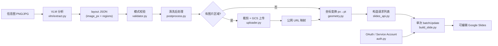
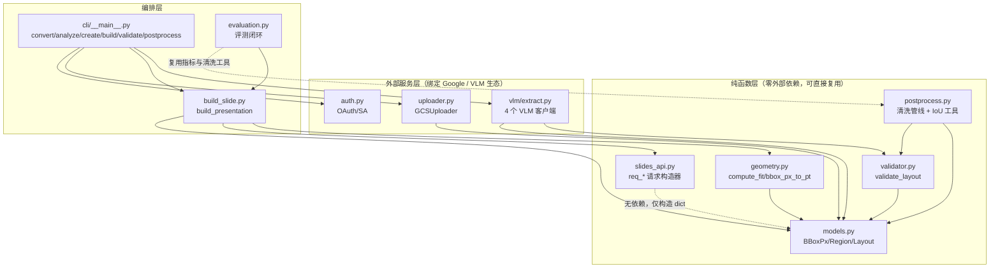
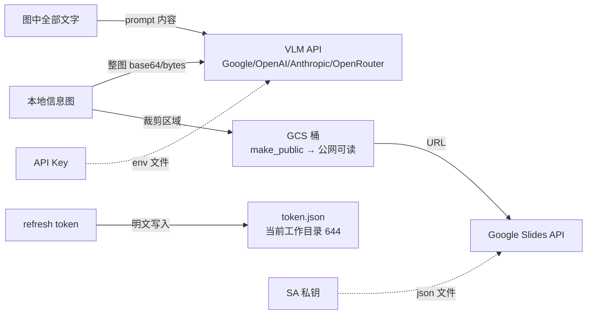

# images2slides 仓库评估报告

> **评估对象**：<https://github.com/kumanday/images2slides.git>
> **评估视角**：开发复用（架构可否二次开发、模块可否抽取集成）
> **评估方式**：全量源码深度走读 + 本地实际运行验证（pytest / ruff / black / mypy）
> **评估基准 commit**：`9d5abfb`（main，2026-02-01）
> **报告性质**：定性分析，不打分；改进建议具体到文件与代码位置

---

## 目录

- [1. 执行摘要（TL;DR）](#1-执行摘要tldr)
- [2. 项目概览](#2-项目概览)
- [3. 架构分析](#3-架构分析)
- [4. 代码质量走读](#4-代码质量走读)
- [5. 功能与易用性](#5-功能与易用性)
- [6. 工程化程度](#6-工程化程度)
- [7. 安全与隐私](#7-安全与隐私)
- [8. 复用性评估（开发复用视角）](#8-复用性评估开发复用视角)
- [9. 改进建议清单](#9-改进建议清单)
- [10. 结论](#10-结论)
- [附录 A：本机验证记录](#附录-a本机验证记录)

---

## 1. 执行摘要（TL;DR）

**images2slides 是一个用视觉语言模型（VLM）把静态信息图"反编译"为可编辑 Google Slides 的 Python CLI 工具。** 它解决的是一个真实且少有人做干净的痛点：图片转 PPT 不是简单贴图，而是把图中的文字、图标、图表还原成原生可编辑元素。项目整体处于 **Alpha 成熟度（v0.1.0）**，但完成度超出典型个人项目：核心管线分层清晰、131 个单元测试全部通过、附带一套自研的端到端效果评测系统（evaluation.py，含 IoU/CER/WER 指标）。

**核心优势**：

- **架构分层教科书级干净**：数据模型、校验、后处理、几何变换、API 请求构造、编排六层各司其职；`slides_api.py` 是纯函数式的请求构造器（不触网），天然可测试、可复用。
- **不可变数据模型**：全部使用 `frozen dataclass`，转换函数返回新对象，数据流向清晰。
- **扩展点设计有意识**：`VLMClient` / `Uploader` 均为 Protocol 接口，可替换后端（S3、本地 HTTP 服务等）。
- **罕见的自建评测闭环**：用 Gemini 生成 ground-truth 信息图，再用 IoU/CER/WER/中心偏移等指标量化抽取质量——多数同类开源项目没有这一层。

**主要短板**：

- **4 个 VLM 客户端约 75% 代码复制粘贴**（`vlm/extract.py`），JSON 解析逻辑复制了 4 份，是最大的重构欠账。
- **依赖卫生问题**：`pydantic` 声明为核心依赖但全仓库零使用；`polars`（重型 Rust 依赖）仅为 1428 行的 evaluation 脚本服务却打进了核心依赖。
- **安全设计粗糙**：裁剪出的图片区域上传 GCS 后 `make_public()` 直接公网可访问；OAuth token 默认写入当前工作目录且未收紧权限。
- **工程化断点**：无 CI/CD；mypy 配置了严格模式却有 25 个错误未清零；black 格式在 8 个测试文件上漂移；CLI（722 行）零测试。
- **文档陈旧**：`docs/` 下大量残留旧项目名 `slides_infographic`/`slides-infographic`，与实际包名 `images2slides` 不一致，照着文档敲命令会失败。

**复用结论（面向二次开发）**：`models.py`、`geometry.py`、`validator.py`、`postprocess.py`、`slides_api.py` 五个模块近乎零依赖、可整体抽走直接用；`vlm/` 收敛重复后可作为多 Provider VLM 抽取基座；与 Google 生态强绑定的 `auth.py`/`uploader.py` 需按目标环境适配。**layout.json 中间格式是本项目最有价值的集成契约**，建议原样保留作为系统总线。

---

## 2. 项目概览

### 2.1 基本信息卡

| 项目 | 内容 |
|---|---|
| 名称 / 版本 | images2slides，v0.1.0（Development Status :: 3 - Alpha） |
| 语言 / 运行时 | Python 100%，要求 ≥ 3.11，用 uv 管理依赖 |
| 许可证 | MIT |
| 代码规模 | 约 6,551 行（核心包 2,265 + CLI 722 + 测试 2,059 + evaluation 1,428 + 配置） |
| 社区热度 | 5 stars / 0 forks / 0 watchers（截至评估日，冷启动阶段） |
| 提交历史 | 仅 7 个 commit（2025-12-22 ~ 2026-02-01），单一作者 Leonardo Gonzalez |
| 分支结构 | main + feat/evaluation + fix/background + **4 个 `feat/saas/*` 分支**（见 2.3） |
| CI/CD | 无（无 `.github/` 目录） |

### 2.2 它做什么

给定一张（或多张）信息图 PNG/JPG，系统执行四步管线：

1. **VLM 分析**：把图片发给配置的视觉模型（Gemini / GPT / Claude / OpenRouter 四选一），要求输出结构化 JSON——每个文字区域和图片区域的精确包围盒、文本内容、字体样式提示、置信度。
2. **校验与清洗**：`validator.py` 做模式校验和类型转换，`postprocess.py` 做空白修剪、空区域剔除、边界钳制、阅读顺序排序、最小尺寸强制。
3. **（可选）图片区域裁剪上传**：图标/图表等区域从原图裁出，上传到 GCS 拿公网 URL（Google Slides API 要求图片必须可通过 URL 访问）。
4. **幻灯片重建**：`geometry.py` 把像素坐标按等比缩放映射到幻灯片点坐标，`build_slide.py` 构造一次 `batchUpdate` 请求批量创建文本框（透明背景）与图片元素。

### 2.3 值得注意的开发模式：AI 模型对比实验仓库

git 历史透露了项目的真实背景：除 main 外存在 4 个并行分支 `feat/saas/glm4.7`、`feat/saas/gpt-5.2`、`feat/saas/m2.1`、`feat/saas/opus-4.5`，对应提交信息为 "feat: SaaS initial commit by \<模型名\>"。也就是说，**作者在用同一代码基座，让四个不同的 AI 模型各自实现 SaaS 化改造，然后横向对比**（如 glm4.7 分支含 3,443 行新增）。这与提交者邮箱（trilogy.com 域名）结合看，该项目大概率是 AI 工程效能对比研究的产物。对本评估的影响：main 分支代表"人类/AI 协作打磨过的基线"，质量可信度较高；同时说明作者对工程质量有系统性要求（自建评测集即为此服务）。

---

## 3. 架构分析

### 3.1 管线数据流



### 3.2 模块依赖关系



### 3.3 设计亮点（值得借鉴的决定）

1. **数据模型全部 frozen**（`models.py:10-188`）：`BBoxPx`/`TextStyle`/`Region`/`Layout` 均为 `frozen=True` dataclass，配套 `to_dict`/`from_dict`。好处是线程安全、可哈希、转换语义明确（返回新对象）；代价是 `postprocess.py` 每个清洗函数都要手工重建 Region（6 个字段抄写一遍，见 4.2 的改进点）。
2. **请求构造与 API 执行彻底分离**（`slides_api.py` 全文 + `build_slide.py:185-217`）：`req_*` 系列函数只产出纯 dict，`apply_requests` 才触网。这使得整个幻灯片重建逻辑可以在无网络环境下单测——`test_build_slide.py` 正是这样做的。
3. **确定性对象 ID**（`docs/architecture.md` 明确记录）：`SLIDE_000`、`TXT_<region_id>`、`IMG_<region_id>`、`BG_<slide_id>`。同一布局重放请求不会产生重复元素，天然支持安全重试与调试定位。
4. **单次 batchUpdate 原子提交**（`build_slide.py:370-404`）：所有幻灯片的所有请求合并进一次 `batchUpdate`，要么全成功要么全失败，避免"半成品演示文稿"。
5. **Protocol 化的扩展点**：`VLMClient`（`vlm/extract.py:68-73`）与 `Uploader`（`uploader.py:22-35`）都是 `typing.Protocol`， duck-typing 替换后端无需继承。
6. **懒加载 SDK 客户端**：Google/OpenAI/Anthropic SDK 都在 `_get_client()` 里才 import（如 `vlm/extract.py:83-89`），安装体积和启动时间不受全量 provider 影响。
7. **自建评测闭环**（`evaluation.py`）：Gemini 生成 GT 版式 → 生成组件图 → 拼装 GT 信息图 → 跑抽取管线 → 归一化坐标上做匈牙利式最优匹配 → 输出 IoU/CER/WER/中心偏移/恢复率/分位数指标 → polars 汇总统计。这套指标体系（`evaluation/README.md` 定义了 40+ 列）在同类项目中极为罕见，是本项目工程严肃性的最强信号。

### 3.4 架构层面的隐忧

1. **`build_presentation` 把所有幻灯片塞进一个 batchUpdate**（`build_slide.py:403-404`）：请求量 = 幻灯片数 ×（1 + Σ区域请求数）。一张 30 区域的信息图约 120+ 请求；10 张图就是 1000+ 请求的单次调用。Google Slides API 对单次请求体大小有实际限制，大演示文稿会撞墙且失败后无法断点续传（确定性 ID 让重试安全，但整个批次要重来）。
2. **清洗与校验的双入口**：`validator.validate_layout`（dict → Layout，抛异常）与 `postprocess.validate_layout`（Layout → warnings，返回列表）**同名不同义**（`validator.py:64` vs `postprocess.py:295`）。CLI 的不同命令分别 import 两者，容易在二次开发时 import 错。
3. **`cli/__main__.py` 在 import 时执行 `.env` 查找**（`cli/__main__.py:33` 模块级调用 `_load_env_file()`）：作为库被 import 也会触发文件系统扫描，属副作用设计。
4. **`convert` 与 `create`/`build` 三条命令各自实现了一遍"加载→校验→清洗→鉴权→构建"**（`cli/__main__.py:114-175、327-415、554-718`），约 200 行结构性重复，加新命令时会继续复制。

---

## 4. 代码质量走读

> 走读顺序按数据流排列；每个模块给出职责、质量印象与具体问题定位。

### 4.1 `models.py`（187 行）— 数据模型 ✅ 质量优秀

四个 frozen dataclass + 手写序列化。类型标注完整（`Literal["text", "image"]`、`tuple[Region, ...]`），`from_dict` 做了防御性转换（`float()`/`int()`/`str()`）。

- ⚠️ `Region.from_dict`（`models.py:101-113`）不校验 `type` 字段合法性——传 `"foo"` 也能构造出 Region（`Literal` 类型注解骗过了 mypy 但运行时无检查）。`validator.py` 里有校验，但绕过 validator 直接用 `Region.from_dict` 时这道防线不存在。数据模型自洽性与校验逻辑分离在两个文件，是隐患。

### 4.2 `postprocess.py`（416 行）— 清洗与度量 ⚠️ 功能好，实现有冗余

六步清洗管线（`postprocess_layout`，`postprocess.py:171-186`）顺序合理：trim → 空格归一 → 删空区域 → 边界钳制 → 阅读序排序 → 最小尺寸。IoU 计算（`compute_bbox_iou`，212-239 行）实现正确。

- ⚠️ **6 个清洗函数每个都手工重建整个 Region**（如 `postprocess.py:25-37、56-68、107-119、152-164`），字段清单重复 6 次。一旦 `Region` 加字段（比如颜色），这里会漏改。frozen dataclass 正确姿势是 `dataclasses.replace(r, text=r.text.strip())`，一行即可。
- ⚠️ **`enforce_minimum_size` 在 `clamp_to_bounds` 之后执行**（`postprocess.py:180-185`）：把小于 10px 的区域扩到 10px 可能把已钳制到图像右/下边缘的区域重新推出边界。顺序应互换或扩后二次钳制。
- ⚠️ **`validate_layout` 命名冲突**（`postprocess.py:295-369`）：与 `validator.validate_layout` 同名不同语义（一个抛异常、一个返回 warnings 列表），`evaluation.py:36-37` 同时 import 两者时只能靠模块前缀区分。应改名如 `audit_layout`。
- ⚠️ `get_layout_statistics` 的 `coverage_ratio`（`postprocess.py:400-403`）直接累加区域面积 / 图面积，区域重叠时会大于 1，语义上不是"覆盖率"。

### 4.3 `vlm/extract.py`（558 行）— 最大重构欠账 ❌ 复制粘贴重灾区

四个 provider 客户端 `GoogleVLMClient` / `OpenAIVLMClient` / `AnthropicVLMClient` / `OpenRouterVLMClient` 结构完全平行，每个约 100 行：

- **`_parse_json_response` 复制了 4 份**（`vlm/extract.py:147-184、259-281、358-380、460-482`）。Google 版多了"疑似截断"提示（174-176 行），其余三份逐字符相同。修一个 bug 要改四处。
- **mime type 查表、图片尺寸读取、prompt 拼装（`prompt_with_dims`）在 4 个类中各出现一遍**（如 103-118、212-227、310-324、413-428 行）。
- 四者真正的差异只有：SDK import、请求体构造（约 15 行）、响应文本提取（1 行）。**一个基类 + 模板方法可把 558 行压到约 250 行**。
- ⚠️ **无重试、无超时、无退避**：VLM 调用裸奔（`vlm/extract.py:122-139`），429/网络抖动直接抛 `VLMExtractionError` 终止整条管线。对批量转换场景是可用性硬伤。
- ⚠️ OpenAI/Anthropic/OpenRouter 三家的 `_get_client` 在 provider 未装对应 SDK 时抛裸 `ImportError`，用户得到的是堆栈而非引导信息（README 未说明 `openai`/`anthropic` 是 optional 依赖组 `vlm`，需 `uv sync --extra vlm`）。
- ✅ JSON 解析的兜底策略本身不错：剥 markdown 围栏 → 直接 loads → 正则抽 `{...}` → 带截断诊断的报错（Google 版）。

### 4.4 `validator.py`（113 行）— 校验 ✅ 干净

必填字段、类型检查、bbox 数值类型校验、`clamp_bbox_to_bounds` 钳制。错误消息带索引前缀（`regions[2].bbox_px`）便于定位。

- ⚠️ **不校验 region id 唯一性**。而下游 `build_slide.py:115/171` 用 `TXT_{region.id}`/`IMG_{region.id}` 当 Slides 对象 ID——VLM 产出重复 id（实践中会出现）时 batchUpdate 直接 400 失败，且错误信息不会指向"id 重复"这个根因。校验器加一行 set 判断即可根除。

### 4.5 `geometry.py`（61 行）— 坐标变换 ✅ 质量优秀

纯函数、文档清晰、边界正确（contain-fit + 居中）。**这是全仓库复用成本最低的模块**，无任何项目内依赖以外的 import（仅依赖 models）。

### 4.6 `slides_api.py`（221 行）— 请求构造器 ✅ 质量优秀

9 个 `req_*` 纯函数覆盖 createSlide/createImage/createShape/insertText/透明化/textStyle/deleteObject。`req_text_style` 的 fields 动态拼装（`slides_api.py:168-191`）正确处理了"部分更新"语义。

- ⚠️ `PAGE_SIZES["CUSTOM"] = None`（`slides_api.py:10-11`）是死代码：`get_page_size_body` 遇到 CUSTOM 会 `TypeError: cannot unpack non-sequence NoneType`，而类型 `PageSizePreset` 又不含 CUSTOM，两头不讨好。

### 4.7 `build_slide.py`（453 行）— 编排 ⚠️ 核心逻辑好，魔法数与风险点集中

- ⚠️ **字体非线性放大系数是裸魔法数**：`build_slide.py:123` 的 `boost = max(0, (14 - base_scaled) * 0.294)`。注释说明了标定目标（5.5pt→8pt，14pt 以上不变），但 0.294 这个拟合斜率没有出处说明、不可配置。对二次开发者，这是"改了会破坏效果但不知道为什么"的典型雷区，应提取为模块级常量并在 docstring 里写明标定方法。
- ⚠️ **文本框宽度防重叠逻辑**（`build_slide.py:134-150`）只考虑了右侧邻居（`ox > x_pt`），不处理左侧/上方邻居加宽后的连锁影响；且 `oy < y_pt + h_pt and oy + oh > y_pt` 的垂直重叠判断在区域紧贴时会产生 2pt gap 的边界抖动。可用但不精确。
- ⚠️ `build_presentation` 的巨型单批次问题（见 3.4.1）。
- ⚠️ `build_slide()`（单页版本，220-262 行）与 `build_presentation()`（多页版本，336-414 行）各自获取页面尺寸（一个走 API `get_page_size_pt`，一个走本地常量 `PAGE_SIZES`），两条路径对"页面尺寸"的认知来源不一致，自定义页面尺寸的演示文稿（通过 API 创建后）走 build_slide 是对的，走 build_presentation 是错的。
- ✅ 429 限流单独识别（`build_slide.py:213-214`）是细节加分项。

### 4.8 `uploader.py`（191 行）— 裁剪上传 ⚠️ 有安全隐患（详见第 7 节）

- ⚠️ `blob.make_public()`（`uploader.py:81-84`）+ 异常吞掉后仍返回 public_url：统一桶级权限的桶上对象 ACL 设置会失败，代码"乐观地"返回 public_url，实际是否公开取决于桶配置——**上传者无从确认图片是否真的可访问，也不感知它已经公网暴露**。
- ⚠️ 10px 裁剪 padding 只加右下方向（`uploader.py:108-112`），注释承认是补偿 VLM bbox 偏紧，但魔法数不可配置、方向不对称（图标贴左边缘时会裁掉左边）。
- ⚠️ `crop_and_upload_regions` 任一区域上传失败即 `raise`（`uploader.py:174-176`）中止整条管线——一张小图标上传失败会毁掉整次转换，降级策略（跳过该区域，文本仍在）明显更合理。
- ✅ 内容哈希参与对象命名（`get_file_hash`，120-133 行）避免缓存击穿，设计意识好。

### 4.9 `auth.py`（47 行）— 鉴权 ⚠️ 能用但简陋

- ⚠️ `token_path: str = "token.json"` 默认落到**当前工作目录**（`auth.py:14`），且 `creds.to_json()` 含 refresh token、文件权限未收紧（默认 umask 644）。README 与文档均未提示该文件位置与敏感级别。
- ⚠️ scope 只有 `presentations`（`auth.py:11`）——最小权限值得肯定；但 GCS 上传走的是 `storage.Client()` 的 ADC 凭据（`uploader.py:54-57`），与 Slides 的 OAuth 凭据**是两套独立凭据体系**，混合环境下会出现"Slides 授权成功但 GCS 上传 403"的割裂体验，文档未提示需要 `gcloud auth application-default login`（仅 development.md troubleshooting 提了一句）。
- ⚠️ `token.json` 已在 `.gitignore`，✅。

### 4.10 `cli/__main__.py`（722 行）— 命令行 ⚠️ 体验尚可，结构重复

6 个子命令（convert/analyze/create/build/validate/postprocess），配置三级回退（CLI > 环境变量 > .env）实现正确（`override=False` + CLI 显式覆盖），退出码分类（0/1/2/3/4）是加分项。

- ⚠️ 三条主命令重复实现加载-校验-清洗-鉴权-构建骨架（见 3.4.4）。
- ⚠️ `postprocess` 命令手工重建输出 dict（`cli/__main__.py:236-268`）——`Layout.to_dict()` 已经存在，这里 30 行是纯冗余，且手工版没有和 `to_dict` 同步的保证。
- ⚠️ `create` 命令 import 了 `PresentationResult` 仅作类型注解（`cli/__main__.py:341-347`），运行时未使用。
- ⚠️ 所有 docstring 里的示例命令还是旧名 `slides-infographic convert ...`（如 339、455、574 行），实际入口是 `images2slides`。

### 4.11 `evaluation.py`（1,428 行）— 评测系统 ✅ 内容超配，⚠️ 单文件巨石

作为 Alpha 项目的配套评测系统，指标设计（元素恢复率、IoU 分位数、CER/WER、归一化中心偏移、计时）相当专业。问题集中在实现层面：

- ⚠️ **自实现的指派算法是指数复杂度**：`_assignment_dp`（`evaluation.py:267-293`）用 `functools.cache` + 位掩码 DP，状态空间 O(rows × 2^cols)。代码在 cols > 24 时只打 warning 仍继续跑（270-271 行），一张 30 区域的信息图会让 GT 匹配阶段卡死。标准解法是 `scipy.optimize.linear_sum_assignment`（O(n³) Jonker-Volgenant），或至少换成贪心 + 阈值松弛。自实现的动机大概是避免引入 scipy，但代价不成比例。
- ⚠️ 单文件 1,428 行混合了：GT 生成、图像生成、指标计算、匹配算法、CSV/汇总输出、CLI。指标计算部分（`match_text_regions`/`match_image_regions`/`evaluate_layouts`，607-826 行）其实是可独立成库的通用"版式对比"工具，埋在巨石里无法复用。
- ⚠️ `parse_json_response`（178-195 行）是第 5 份 JSON 解析复制（4 份在 vlm/extract.py）。
- ✅ `functools.cache`、严格 `zip(strict=)`、UTC 时间戳、git commit 写入 run_meta——细节习惯好。

### 4.12 测试代码（8 文件，2,059 行）✅ 质量好但覆盖不均

131 个用例 0.41s 跑完，全部纯 mock/纯函数测试（无网络依赖）。`test_build_slide.py` 甚至把字体放大的标定值写成断言（188-189 行，`pytest.approx(12.588)`）——把魔法数的行为锁进了测试，算是给 4.7 的魔法数上了"变更报警"保险。缺口：CLI 七百行零测试、`auth.py` 零测试、`evaluation.py` 零测试（评测系统本身没有评测）。

---

## 5. 功能与易用性

### 5.1 功能完整度

| 能力 | 状态 | 说明 |
|---|---|---|
| 端到端转换（convert） | ✅ 可用 | 图片 → VLM → 清洗 → 建演示文稿，一条命令 |
| 仅分析（analyze） | ✅ 可用 | 输出 layout JSON，是很好的调试/集成入口 |
| 从 JSON 重建（create/build） | ✅ 可用 | 支持跳过 VLM 直接用布局文件 |
| 多图合成多页 | ✅ 可用 | insertionIndex 保证页序 |
| 16:9 / 16:10 / 4:3 | ✅ 可用 | 预设齐全，无自定义尺寸入口 |
| 图片区域还原 | ⚠️ 受限 | 必须 GCS + 公开桶；无 S3/本地替代实现 |
| 字体样式还原 | ⚠️ 近似 | 依赖 VLM 猜测 + 非线性放大补偿，效果靠 evaluation 把关 |
| 背景图模式 | ✅ 可用 | `place_background` 开关，但 convert 主路径硬编码 False（`cli/__main__.py:694`） |

### 5.2 上手成本（开发复用视角）

- **安装**：`uv sync` 一条命令，锁文件齐全（uv.lock 250KB），本机实测一次成功，无编译依赖（全部纯 Python 或有 wheel）。这个体验是好的。
- **首次运行门槛高**：需要同时备齐 **VLM API Key + Google Cloud 项目 + Slides API 启用 + OAuth 客户端（或服务账号）+（要还原图标时）GCS 公开桶**——五件套。README 的引导写得足够细（截图级步骤都有），但这是产品形态决定的门槛，不是文档问题。
- **断点调试友好度好**：`analyze` 命令可单独产出 layout JSON，`validate`/`postprocess` 可离线检查，`--save-layouts` 可留存中间产物。管线各环节可单独验证，这对二次开发者是实打实的便利。
- **示例薄弱**：`examples/` 只有一个 `sample_layout.json`，没有示例图片、没有"预期输出"截图、没有 layout JSON 的逐字段注释文档（字段说明散落在 VLM prompt 里）。

### 5.3 文档质量 ⚠️ 内容详实但系统性过期

四篇 docs（architecture/development/configuration/api-reference）结构专业、内容有深度，但**全部停留在改名前**：

- `docs/development.md`：包名写 `slides_infographic`（74-97 行目录树）、CLI 名写 `slides-infographic`（49、409 行）、覆盖率命令 `--cov=slides_infographic`（130 行）——照做全部失败；
- `docs/configuration.md`：声称 `PRESENTATION_ID` 是"必需变量"，但 main 分支的 convert/analyze 根本不用它（只有旧 build 命令用）；声称 `TOKEN_PATH` 变量存在，代码里没有（`auth.py` 的 token_path 是函数参数非环境变量）；
- `docs/architecture.md`：CLI 命令清单缺 convert/analyze/create 三个主力命令（165-170 行）；依赖清单说 pydantic 是 "(optional)"，实际在核心依赖且未使用；
- 测试数量表（development.md 136-145 行）与实际用例数有出入（文档 100 个，实际 131 个）。

**文档与代码的漂移说明项目没有"文档即测试"机制（如 doctest/CI 校验），也没有发布纪律。** 对复用者，文档可信度要打折：以代码为准，docs 只当设计意图参考。

---

## 6. 工程化程度

### 6.1 实测验证结果（本机 Python 3.12.15 + uv 0.13.0）

| 检查项 | 命令 | 结果 |
|---|---|---|
| 依赖安装 | `uv sync` | ✅ 一次成功 |
| 单元测试 | `uv run pytest` | ✅ **131 passed，0.41s** |
| Lint | `uv run ruff check` | ✅ All checks passed |
| 格式 | `uv run black --check` | ❌ **8 个文件需重排**（全部是 tests/ 下的文件） |
| 类型检查 | `uv run mypy images2slides` | ❌ **25 个错误**（11 no-any-return、4 no-untyped-def、4 import-untyped、2 import-not-found、1 return-value、1 list-item） |

解读：**测试是真实的且全绿**（这是最值钱的部分）；ruff 规则选得合理（E/W/F/I/B/C4/UP）；但 black 漂移集中在 tests/ 说明最后一次提交（evaluation 相关改动）没有跑完整格式化；mypy 配置了 `disallow_untyped_defs = true` 这种严格选项，却带着 25 个错误合入——**配置存在但未纳入门禁**，等于声明了标准没执行标准。

### 6.2 CI/CD：缺失 ❌

无 `.github/workflows`。pyproject 里 pytest/pytest-cov/black/ruff/isort/mypy 一应俱全，README 也写了命令，但没有 CI 强制执行。对一个"用四个 AI 模型并行开发 SaaS 分支"的工作流来说，没有 CI 门禁意味着 main 的质量完全依赖提交者自觉——现有 131 个测试的价值因此打了折扣（回归要靠人肉跑）。

### 6.3 依赖卫生 ⚠️ 三处问题

1. **`pydantic>=2.0.0` 全仓库零使用**（`pyproject.toml:31`；grep 证实无任何 import）。疑似早期用了 pydantic 后来换成手写 dataclass，依赖忘了删。纯冗余。
2. **`polars>=0.20.0` 放在核心依赖**（`pyproject.toml:30`）：仅 `evaluation.py:1112` 的 collate 功能使用。polars 携带 Rust 原生库（约 30MB 级），让每个 `pip install images2slides` 的用户为一条评测命令买单。应移入 dev/optional 组。
3. **核心依赖打包了全部 Google 生态**（api-python-client/auth/oauthlib/httplib2/cloud-storage/genai 五件套，`pyproject.toml:23-28`）：只做 VLM 分析不需要 GCS，只用 Slides 不需要 genai。对比之下 openai/anthropic 反而是 optional——分组策略不一致，方向反了（最重的 google-cloud-storage 没进 optional）。

### 6.4 版本管理纪律 ⚠️

- 7 个 commit、无 tag、无 CHANGELOG、`__init__.py` 版本 0.1.0 与 pyproject 一致（✅）但从未发布到 PyPI。
- `.gitignore` 用 `*.json` 全局忽略 + 两个白名单（`!examples/*.json`、`!tests/fixtures/*.json`）：对密钥保护很稳（✅），但任何新增目录里的 JSON 默认都被忽略，贡献者会困惑"为什么我的文件加不进 git"；`*.png` 全局忽略同理意味着示例图片永远进不了仓库。
- 单作者单人开发，无 PR 合并痕迹（直接推 main），无 CODEOWNERS。

---

## 7. 安全与隐私

> 本节按"数据从哪来、到哪去"梳理攻击面。该工具处理的图片可能是**未公开的内部材料**（内部数据报告、未发布产品的信息图），以下风险要放在这个语境下评估。

### 7.1 数据流向图



### 7.2 风险清单（按严重度排序）

| # | 风险 | 位置 | 说明 |
|---|---|---|---|
| S1 | **裁剪图公开上传且无提示** | `uploader.py:80-86` | `make_public()` 把图标/图表裁剪件永久公开（无过期、无签名 URL）。即使 `make_public` 失败也照样返回 public_url 继续流程，上传者不感知失败。内部材料的图表片段由此进入公网。**建议：改用带过期时间的签名 URL（Slides API 支持），或至少在文档显著位置声明"上传即公开"。** |
| S2 | **OAuth refresh token 明文落盘 CWD** | `auth.py:14、31-32` | `token.json` 含 refresh token，写入当前工作目录、权限 644。若用户在共享目录/容器挂载卷/网页服务器目录运行，凭据泄露面大。**建议：默认写 `~/.config/images2slides/` 并 `os.chmod(token_path, 0o600)`。** |
| S3 | **整图发给第三方 VLM** | `vlm/extract.py`（各 client） | 属产品固有行为，但 README/文档**没有任何隐私声明**——图片内容（含敏感文字）会发送给所选 provider 并受其数据政策约束。企业场景需要先过合规。建议在 README 增加数据流披露章节。 |
| S4 | **异常消息可能携带敏感片段** | `vlm/extract.py:179-184` | JSON 解析失败时把响应前 300 字/后 200 字打进异常消息与日志；VLM 响应内容即用户图片内容。日志系统默认 INFO 级别输出到 stderr，CI 环境下会进日志平台。 |
| S5 | **.env 与凭据文件的相对路径解析** | `cli/__main__.py:14-30` | `.env` 从 CWD 向上递归查找到 `pyproject.toml` 为止——在父目录意外存在另一个项目的 `.env` 时会静默加载错配置（含错误的 API Key），key 打到错误账号/配额。低概率但排障极难。 |
| S6 | **GCS 凭据与 Slides 凭据双轨** | `uploader.py:54-57` vs `auth.py` | GCS 用 ADC（环境级凭据，权限可能远大于预期），Slides 用显式文件。两套凭据、两套权限模型，最小权限原则在 GCS 侧失控（ADC 在 GCE 环境常是项目级 Editor）。 |

**做得好的方面**：`.gitignore` 对 `secrets/`、`token.json`、`.env` 的覆盖完整；OAuth scope 最小化（仅 presentations）；`.env.example` 无真实密钥；仓库内未发现任何硬编码凭据（grep 证实）。

---

## 8. 复用性评估（开发复用视角）

### 8.1 模块可复用性分级

| 等级 | 模块 | 复用成本 | 说明 |
|---|---|---|---|
| 🟢 **直接抽走** | `models.py` | 零 | 纯 stdlib（dataclasses/typing/json），复制即用 |
| 🟢 **直接抽走** | `geometry.py` | 零 | 仅依赖 models，纯函数 |
| 🟢 **直接抽走** | `validator.py` | 零 | 仅依赖 models |
| 🟢 **直接抽走** | `slides_api.py` | 零 | 只产出 dict，连 models 都不依赖；**全仓库最有复用价值的模块**——任何要调 Google Slides API 的项目都能白拿这 221 行 |
| 🟢 **直接抽走** | `postprocess.py` 的清洗函数与 IoU 工具 | 零 | 需先做 4.2 节的重构（replace 化） |
| 🟡 **收敛后复用** | `vlm/` 包 | 低 | Protocol 设计是对的，先把 4 份重复收敛成基类；收敛后就是一个可挂新 provider 的"图片→结构化版式 JSON"抽取器，可服务 Slides 之外的场景（如 Figma 导入、HTML 重建） |
| 🟡 **适配后复用** | `uploader.py` | 中 | `Uploader` Protocol 已抽象；写一个 S3Uploader/本地 HTTP Uploader 即可解绑 GCS；`crop_region_png` 可独立复用 |
| 🟠 **需绑定生态** | `auth.py`、`build_slide.py` | 高 | 前者绑 Google 鉴权；后者虽然编排逻辑通用，但字体放大/防重叠策略与 Slides 点坐标系耦合 |
| 🔵 **拆库候选** | `evaluation.py` 的指标部分 | 中 | `match_text_regions`/`match_image_regions`/`evaluate_layouts`（607-826 行）+ IoU/CER/WER 工具可拆成独立的"版式对比"库（需替换指数级指派算法）；GT 生成部分与具体 API 耦合，不值得复用 |

### 8.2 集成契约：layout.json 是最好的复用资产

```json
{
  "image_px": {"width": 1600, "height": 900},
  "regions": [
    {
      "id": "title", "order": 1, "type": "text",
      "bbox_px": {"x": 120, "y": 80, "w": 1360, "h": 120},
      "text": "...", "style": {"font_family": "Arial", "font_size_pt": 28, "bold": true},
      "crop_from_infographic": false, "confidence": 0.95, "notes": null
    }
  ]
}
```

这个中间格式设计得当：像素坐标系（与图片直接对应）、文本/图像二分、置信度与备注留了 VLM 不确定性的表达口子。**如果您的系统要和 images2slides 集成，建议把 layout.json 当作唯一的集成总线**——上游换 VLM、下游换渲染目标（Slides/PowerPoint/HTML），格式都不用动。唯一遗憾是它没有 JSON Schema 文件（字段定义散落在 VLM prompt 和 validator 代码里），复用时建议先补一份 schema。

### 8.3 二次开发的推荐路径

若目标是"基于它做一个自己的图片转幻灯片服务"：

1. **保留**：models / validator / postprocess / geometry / slides_api 五模块原样入库，layout.json 作为接口冻结；
2. **重构**：vlm/extract.py 按 4.3 节收敛成基类（这是动手前必做项，否则每个新功能都要改 4 处）；
3. **替换**：按目标存储环境实现新的 `Uploader`（Protocol 已备好）；鉴权按部署形态选 OAuth/SA；
4. **加固**：补 CI（测试现成）、补 region id 唯一性校验、给 batchUpdate 按幻灯片分批；
5. **继承**：evaluation.py 的评测思路值得照搬——换一个 VLM/换一个 prompt 后跑同一套指标，回归有数字可依。

---

## 9. 改进建议清单

> 按优先级排列：P0 = 合入前应修（正确性/安全）；P1 = 短期（两周内）；P2 = 打磨项。每条标注具体位置。

### P0 — 正确性与安全

| # | 建议 | 位置 | 预期工作量 |
|---|---|---|---|
| P0-1 | `validate_layout` 增加 **region id 唯一性校验**（重复 id 会使 batchUpdate 400 且难排查）；顺带校验 `type` 字段运行时合法性 | `validator.py:64-95`（或 `models.py:101`） | ~10 行 + 2 个测试 |
| P0-2 | 裁剪图上传改**签名 URL**（`blob.generate_signed_url(expiry=...)`）替代 `make_public()`；若保留公开桶方案，`make_public` 失败时应显式告警而非静默继续 | `uploader.py:80-86` | ~30 行 |
| P0-3 | OAuth token 默认路径改 `~/.config/images2slides/token.json` 并 `chmod 0o600`；保留参数覆盖能力 | `auth.py:14、28-32` | ~8 行 |
| P0-4 | `crop_and_upload_regions` 单区域失败改**降级收集**（记录失败清单、返回成功映射），管线末尾汇总告警，替代现在的一票否决 | `uploader.py:174-176` | ~15 行 |

### P1 — 重构与工程化

| # | 建议 | 位置 | 预期工作量 |
|---|---|---|---|
| P1-1 | **收敛 4 个 VLM 客户端**：抽 `_BaseVLMClient`（mime 查表、读图、prompt 拼装、`_parse_json_response`、统一异常包装），子类只留 `_build_request`/`_extract_text` 两个钩子；558 行可降到约 250 行 | `vlm/extract.py` 全文 | ~半天（现有 13 个 VLM 测试护航） |
| P1-2 | VLM 调用加**指数退避重试**（建议 `tenacity` 或手写 3 次退避）+ 显式 `timeout` | `vlm/extract.py` 各 `extract_layout` | ~1 小时 |
| P1-3 | 依赖整理：删 `pydantic`；`polars` 移入 dev 组或 `evaluation` extra；考虑把 `google-cloud-storage`/`google-genai` 也做 optional 分组（`[project.optional-dependencies] gcs/vlm`） | `pyproject.toml:22-40` | ~半小时 + 重锁 |
| P1-4 | `postprocess.validate_layout` 改名 `audit_layout`（消除与 `validator.validate_layout` 的同名冲突）；同步更新 `evaluation.py` import | `postprocess.py:295`、`evaluation.py:36` | ~15 分钟 |
| P1-5 | postprocess 清洗函数全部改用 `dataclasses.replace()`，删除 6 处手工字段抄写 | `postprocess.py:25-37、56-68、107-119、152-164` | ~30 分钟 |
| P1-6 | 加 **GitHub Actions**：`pytest + ruff check + black --check + mypy` 四件套门禁；mypy 现有 25 错误先修到 0（多数是 `Any` 收窄和 `_get_client` 返回类型标注） | 新增 `.github/workflows/ci.yml`；`vlm/extract.py:294、370-496` 等 | ~半天 |
| P1-7 | **文档大修**：全局替换 `slides_infographic`/`slides-infographic` → `images2slides`；删除 `configuration.md` 中不存在的 `TOKEN_PATH`/`PRESENTATION_ID` 必需项声明；architecture.md 补 convert/analyze/create 三个命令；README 增加数据隐私披露（图片会发往所选 VLM provider） | `docs/` 全部、README | ~2 小时 |
| P1-8 | `batchUpdate` **按幻灯片分批**（每页一次 batchUpdate，页内仍原子），规避大演示文稿请求体上限；确定性 ID 已保证可安全重试 | `build_slide.py:370-404` | ~1 小时 |
| P1-9 | 为 CLI 补测试：用 `click.testing.CliRunner` 覆盖 validate/postprocess（纯本地命令先覆盖），convert/create 用 mock service | 新增 `tests/test_cli.py` | ~半天 |
| P1-10 | `enforce_minimum_size` 移到 `clamp_to_bounds` 之前（或扩后二次钳制） | `postprocess.py:180-185` | ~10 分钟 |

### P2 — 打磨

| # | 建议 | 位置 |
|---|---|---|
| P2-1 | evaluation 指派算法换 `scipy.optimize.linear_sum_assignment`（O(n³)），删除位掩码 DP；或至少在 cols>24 时硬报错而非 warning | `evaluation.py:250-293` |
| P2-2 | evaluation.py 拆包：`layouteval/`（指标+匹配）/ `gtgen/`（GT 生成）/ `cli`，指标部分可独立发版 | `evaluation.py` 全文 |
| P2-3 | 字体放大系数提取为模块常量并注释标定方法（`FONT_BOOST_THRESHOLD_PT = 14`、`FONT_BOOST_SLOPE = 0.294`），可在 VLMConfig 暴露覆盖 | `build_slide.py:117-126` |
| P2-4 | `postprocess` CLI 命令改用 `Layout.to_dict()` 输出，删 30 行手工 dict 拼装 | `cli/__main__.py:236-268` |
| P2-5 | 三条主命令的"加载-校验-清洗-鉴权"骨架抽公共函数 | `cli/__main__.py` |
| P2-6 | 裁剪 padding 参数化（`--crop-padding`），并考虑四方向对称 + 贴边自适应 | `uploader.py:108-112` |
| P2-7 | 删除 `PAGE_SIZES["CUSTOM"]` 死代码，或真正支持自定义尺寸 | `slides_api.py:10-11` |
| P2-8 | `_load_env_file()` 从模块级调用移入 `cli()` 回调，消除 import 副作用 | `cli/__main__.py:33` |
| P2-9 | VLM 解析失败时异常消息截断响应预览（当前 500 字符），避免用户内容进日志 | `vlm/extract.py:179-184` |
| P2-10 | 补 layout.json 的 JSON Schema 文件与示例图片，`examples/` 增加端到端最小样例 | `examples/` |
| P2-11 | `get_layout_statistics.coverage_ratio` 改为去重面积（或改名 `raw_coverage_ratio`） | `postprocess.py:400-403` |
| P2-12 | JSON 解析逻辑统一为一处实现后，让 `evaluation.parse_json_response` 也复用它（当前 5 份复制） | `evaluation.py:178-195` |

---

## 10. 结论

**images2slides 是一个"骨架优秀、细节欠账"的 Alpha 项目，对开发复用场景有明显价值，但直接生产使用前需要一轮针对性加固。**

它最难得的地方有三点：一是**分层纪律**——纯函数层（模型/校验/几何/请求构造）与外部服务层（VLM/GCS/鉴权）切分干净，核心逻辑 100% 可离线测试且有 131 个全绿测试背书；二是**扩展点意识**——Protocol 化的 VLMClient/Uploader、确定性的对象 ID、layout.json 中间格式，都为二次开发留好了口子；三是**评测自觉**——自建 GT 生成与量化指标闭环，这在 0.1.0 的项目里几乎见不到，说明作者按"可度量的工程"而非"能跑的 demo"标准在推进。

它需要警惕的地方同样清晰：`vlm/extract.py` 的四份复制代码是后续一切迭代的税费；`make_public` 上传与 token 落盘是两个必须在复用前修掉的安全点；无 CI、mypy 带病合入、文档系统性过期，说明质量工具链"配置了但没执行"；依赖清单里躺着从未使用的 pydantic 和为评测脚本陪绑的 polars。此外，项目高度年轻（单作者、6 周、7 个 commit、5 stars），作为依赖源的持续维护风险需自行评估——好在它最值钱的部分（五个纯函数模块 + layout.json 契约）恰恰是抽走即走、无需长期跟随上游的。

**一句话建议**：把 layout.json 当集成契约、把五模块当起点、把 P0 四条当入库前置条件，然后按 8.3 节路径做二次开发；不要整体 fork 后直接上生产。

---

## 附录 A：本机验证记录

```
环境：Python 3.12.15 / uv 0.13.0 / Linux x86_64
基准：kumanday/images2slides main @ 9d5abfb（feat: evaluation script）

$ uv sync                          → 成功（含 uv.lock 锁定安装）
$ uv run pytest                    → 131 passed in 0.41s
$ uv run ruff check images2slides cli tests evaluation.py
                                   → All checks passed!
$ uv run black --check images2slides cli tests
                                   → 8 files would be reformatted（均为 tests/ 下文件）
$ uv run mypy images2slides        → Found 25 errors in 5 files
                                     （no-any-return ×11, no-untyped-def ×4,
                                       import-untyped ×4, import-not-found ×2,
                                       return-value ×1, list-item ×1, 其他 ×2）

代码量统计（wc -l）：
  images2slides/ 核心包   2,265 行（9 模块 + vlm 子包）
  cli/__main__.py           722 行
  tests/                  2,059 行（8 文件 + conftest）
  evaluation.py           1,428 行
  合计                    约 6,551 行
```

> 本报告基于评估基准 commit 的静态走读与本机动态验证；GitHub 元数据（stars/forks）为评估日快照。报告中所有行号均以该 commit 为准。

